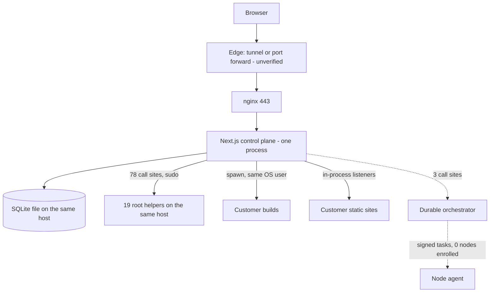

# Phase 0 — Master Audit and Verified Baseline

| | |
|---|---|
| Audit date | 2026-11-11, 18:00–19:30 UTC |
| Audited commit | `c5c81fdd0ae043e3e9729c2eabb1882a72fa9a9d` (`main`) |
| Working branch | `arena/04332d1f-hosting-portal` |
| Scope | Whole repository, CI/CD history, GitHub settings readable by the integration token, a local production build exercised at runtime, and read-only requests to the public production hostname |
| Changes made by this audit | Documentation only (this file plus a one-line pointer in two earlier Phase 0 documents). No application code, schema, workflow, deployment script or Git-protection logic was changed. Nothing was deployed, restarted or migrated. |

This document corrects the two earlier Phase 0 documents where section 4 says so. Their other statements were not all re-verified in this pass; anything not repeated here is carried forward from them, not confirmed by this audit.

- `docs/PHASE-0-VERIFIED-BASELINE-2026-11-11.md` (audited `80318b4b`, committed in `6529d0da`)
- `docs/audit/PHASE-0-INDEPENDENT-REAUDIT-2026-11-11.md` (audited `e8ab0746`, committed in `c19471c7`)

## 0. How to read this document

**Status labels.** Every capability carries exactly one of these, and a higher label is never implied by a lower one.

| Label | Meaning in this document |
|---|---|
| Implemented | Code exists in the audited commit. Nothing more is claimed. |
| Tested | Implemented, and exercised by the automated suite or by the local runtime probes in section 2. |
| Verified in staging | Exercised on a real host that is not production. **Nothing has this label today: no staging environment exists.** |
| Verified in production | Observed on the production system during this audit. |
| Planned | Described in documents or data models, but there is no working code path. |
| Not supported | Absent, and the current infrastructure cannot deliver it. |

**Evidence classes.** "Ran" means the command was executed during this audit and the number is the real output. "Read" means the claim comes from reading the code at the cited path. "Probed" means a read-only HTTP GET to the public production hostname. "Unverified" means it could not be checked from the audit environment; section 10 lists the exact command that settles it.

**Redaction.** This repository is public. No IP address, credential, or reproduction recipe for an unfixed vulnerability appears in this file. Security findings are listed in section 7 by area, severity and status. The endpoint-level details were given to the repository owner privately and are not committed. The probe scripts ran in a disposable audit sandbox outside the repository and were not retained; Phase 0.5 re-creates the failing probes as regression tests in the repository, in the same pull requests as the fixes.

## 1. Baseline recorded before any change

| Item | Value | Evidence |
|---|---|---|
| Branch | `arena/04332d1f-hosting-portal` | Ran `git branch --show-current` |
| Commit | `c5c81fdd0ae043e3e9729c2eabb1882a72fa9a9d`, identical to `main` and `origin/main` | Ran `git rev-parse` |
| Remote branches | `main`; one stale merged branch `arena/6987c648-hosting-portal` | Ran `git branch -a` |
| Uncommitted, staged, untracked | None | Ran `git status --porcelain`, `git diff --cached` |
| Open pull requests | 0 (32 merged, latest #32) | Ran `gh pr list` |
| Latest successful CI run on `main` | Run `43072651421` (#105) on `c5c81fdd`: verify and build succeeded, preflight and deploy skipped | Ran `gh run view` |
| Last CI run whose **deploy job** succeeded | Run #43, commit `ec7ff401`, 2026-10-27 | Ran `gh run view` over 117 runs |
| Current production release | **Unknown commit.** Production reports no release identity (section 3) | Probed |
| History | 135 commits on `main`, first on 2026-10-25 | Ran `git rev-list --count` |
| Protected local directories `aerus-usage-hud/`, `alo-hosting-portal/aerus-usage-hud/` | Not present in this clone and never tracked in history. `.gitignore` lines 82–83 and `scripts/host-checkout-status.sh` lines 62–63 refer to them. Their contents could not be inspected, so that logic was left untouched. | Ran `git log --diff-filter=A`, `git grep` |

## 2. What was executed, and the results

| Check | Result | Notes |
|---|---|---|
| `npm ci --include=dev` | Pass. 650 packages, 0 known vulnerabilities reported by npm | Node 22.22.3, npm 10.9.8 |
| `npm run lint` | Pass, exit 0 | A weak signal: `eslint.config.mjs` switches off 27 rules, including `no-undef`, `no-unreachable`, `no-unused-vars` and `react-hooks/exhaustive-deps` |
| `npm run typecheck` | Pass, exit 0 | |
| `npm test` | Pass. **66 files, 1005 tests, 0 failures**, 61 s | All Vitest in a Node environment. There is no browser end-to-end, load or real-host test tooling in `package.json` |
| `npm run build` | Pass. Next.js 16.4.3, `.next/standalone/server.js` produced | CI placeholder environment, throwaway database |
| `npm run audit:repo` | Pass, 17 of 17 checks | |
| Tracked `db/custom.db` after all runs | Byte-identical to `HEAD` | Ran `git diff --quiet` |
| Secret-pattern scan of full history | No live provider token found. Two items need owner confirmation (finding SEC-09) | 135 commits, 15.7 MB of patches, 14 token patterns |
| Local runtime probes | **49 checks: 42 pass, 7 fail** | See below |

**Local runtime probes.** The production build was started on loopback with random throwaway secrets, a copy of the fixture database outside the repository, and a local emulator standing in for the GitHub API. Two fresh customer accounts were created through the public signup route and used to test each other's boundaries. Production was not involved.

| Group | Checks | Result |
|---|---|---|
| Health endpoint on a fresh build | 1 | Pass |
| Protected API without a session returns 401 | 8 | Pass |
| Administrative API as a customer returns 403 (users, orchestrator jobs, agent enrollment tokens, topology, audit logs, minting an enrollment token) | 6 | Pass |
| CSRF: wrong token, missing token, foreign `Origin` | 3 | Pass |
| Machine endpoints reject a caller with no credential (agent enroll, heartbeat, claim, result; orchestrator tick; automation; cloud key API; SSL hook; both webhooks; worker heartbeat; CRM service API) | 13 | Pass |
| Public signup asking for `SUPER_ADMIN` is downgraded to `CLIENT` | 1 | Pass |
| Default signup creates a `CLIENT` account with a session | 1 | Pass |
| Customer A cannot read, change, deploy or list customer B's deployment project or websites | 5 | Pass |
| GitHub OAuth connect flow completes (against the emulator) | 1 | Pass |
| Customer self-service deploy of a static site: import, then build, activate and HTTP verify | 2 | Pass |
| Build environment contains no platform secret variables | 1 | Pass |
| Git provider integration: tenant isolation | 4 | **Fail** (SEC-02) |
| Build isolation boundary | 1 | **Fail** (SEC-01) |
| Entitlement integrity | 1 | **Fail** (SEC-03) |
| Account type chosen at signup | 1 | **Fail as tested; a product decision** (SEC-06) |

## 3. Production status

All observations are read-only GET requests to `https://hosting.alolabs.net` made between 18:14 and 19:12 UTC on 2026-11-11.

| Observation | Result | Label |
|---|---|---|
| `/api/health`, four requests over 58 minutes (18:14:01, 18:14:22, 18:18:12, 19:12:16) | **HTTP 503 `DATABASE_UNAVAILABLE`** each time. `databaseStatus: disconnected`, `schemaStatus: unavailable`, `environment: production` | Verified in production |
| Release identity in the same response | `release: null`. The running process has no release record, so the live commit cannot be read from outside | Verified in production |
| `uptime` in the same responses | 0 s, 21 s, 251 s, then 3495 s. Each value equals the time since the first request at 18:14:01, because the counter starts at the first request to the route, not at process start (reproduced locally). So one process served all four requests: it is not crash-looping, it did not restart during that hour, and the failure is persistent rather than a start-up transient | Verified in production |
| `/hosting/vps` and `/pricing` | Redirect to the projects showcase. That behaviour was introduced by commit `3a2e7e9` on 2026-11-09 | Verified in production |
| `/register` | Publicly reachable. Offers "Client Account" and "Reseller Partner", and a "$0 free tier" | Verified in production |
| `/api/auth/providers` | Email and password enabled. Google, GitHub and SAML disabled | Verified in production |

Three conclusions follow.

1. **The production control plane is unhealthy.** Its own health check cannot reach the database or finds the schema behind the code. The health route cannot tell those two apart, and neither can an outside observer. Login, signup and every dashboard screen depend on that database.
2. **Production was updated outside the gated release path.** It serves code from 2026-11-09 or later, yet the last CI deploy job to succeed ran on 2026-10-27, the deploy job was skipped in all 13 runs created on or after 2026-11-09, the approval-gated `workflow_dispatch` path has never run (0 of 117 runs), and the process carries no release identity. The approval, ticket, preflight, artifact-digest and identity controls in `.github/workflows/ci-cd.yml` therefore did not govern what is live.
3. **Public claims are ahead of evidence.** The home page states "Scheduled, off-host backups with a restore path that is tested", "Monitored around the clock" and "MFA on every operator account"; the registration page states "automated daily backups" and "PostgreSQL/MySQL provisioning". No off-host backup target exists in the repository, the health endpoint returned 503 for the whole hour this audit observed it, and MFA is opt-in. Under this project's own rule these claims are Unverified until shown on the host.

## 4. Corrections to the earlier Phase 0 documents

| Earlier statement | What this audit found | Evidence |
|---|---|---|
| "Current production release SHA: unknown, no host access" | Still an unknown commit, but now bounded and characterised: code from 2026-11-09 or later, no release identity, health 503 | Probed |
| "Multi-tenancy: org/project scoping consistently enforced in code"; "strong code-level controls" | Not consistent. The Git provider integration fails four tenant-isolation checks at runtime (SEC-02) | Ran |
| "Build isolation (prlimit/namespace) … implemented in places" | Not implemented. No sandbox primitive (`prlimit`, `unshare`, `bwrap`, `systemd-run`, container, separate UID) exists anywhere in `src/`, `helpers/`, `scripts/` or `agent/`. The runtime probe confirms there is no boundary (SEC-01) | Ran, Read |
| Billing has a Stripe "webhook route" | No route references Stripe. `src/lib/stripe.ts` is imported by nothing, and `STRIPE_WEBHOOK_SECRET` is declared and never read | Ran `git grep` |
| The entitlement defect was fixed in PR #32 | Fixed for the AI operator endpoint only. Two other paths remain: one fails at runtime, one was found by reading (SEC-03) | Ran, Read |
| The development fixture "does not ship" in a release | The CI release payload is `.next/standalone`, and the build output contains `db/custom.db` and the full `src/` tree. The Docker build is unaffected because `.dockerignore` excludes `db/*.db` | Ran `ls .next/standalone` |
| 64 test files, 990 tests | 66 files, 1005 tests at the audited commit | Ran |
| "Queued production deploy from 2026-10-27 … possibly outstanding" | Nothing is outstanding. All 117 workflow runs are completed; none is queued, pending or in progress | Ran `gh run list` |

## 5. Verified findings by area

### 5.1 Repository, CI/CD and release control

- The repository is **public** (GitHub API). It contains infrastructure topology, internal audit reports, a database fixture with operator account email addresses and password hashes, and a public IPv4 literal in ten tracked text files, eight of them outside `archive/` (SEC-08).
- One workflow: verify, build, read-only preflight, deploy. Verify and build run on GitHub-hosted runners. Preflight and deploy run on a **self-hosted runner** (`ci-cd.yml` lines 240 and 343). The deploy job releases onto the machine it runs on, so that runner is the production host. Whether it is still registered and online is Unverified (the API returned 403).
- `main` is not protected, there are no rulesets, and the `production` environment has no protection rules. Several pull requests were merged within a minute of opening, before CI could finish (#1, #2, #16, #30). Merging is not gated on checks.
- 117 runs: 71 push, 46 pull request, 0 manual dispatch. The 57 pushes to `main` ended as 19 success, 33 failure and 5 cancelled; the last nine, since 2026-11-02, are green.
- All six records in the GitHub Deployments API are failures for one old commit.

### 5.2 Database

- Engine: SQLite through libSQL. `prisma/schema.prisma` declares `provider = "sqlite"`, `migration_lock.toml` agrees, and `src/lib/db.ts` attaches `@prisma/adapter-libsql` for `file:` URLs. No PostgreSQL or MySQL driver is installed.
- Size: 119 models, 17 enums, 15 migration directories (one is empty).
- Documented production location: an absolute file under `/var/lib/alo-hosting/`. The live location, size and row counts are Unverified.
- Portability: application code has only two raw SQL statements, both in the health route, and no `Unsafe` raw calls. The SQLite-specific work sits in nine scripts (`apply-deploy-schema.mjs`, `db-backup.mjs`, `db-restore.mjs`, `init-production-db.sh` and others) and in the hand-written migrations.
- Tenancy model is mixed. Legacy hosting tables are owned by a user (`ownerId`, `userId`). Cloud Project tables are owned by a project with a membership table. Only eight models carry `organizationId`.
- Integrity gaps: several newer tables reference other rows by plain string id, with no foreign key and no tenant column, and some uniqueness rules are platform-wide where they should be per tenant. The table list is withheld with the security detail and was given to the owner privately.
- When `DATABASE_URL` is unset the application falls back to `file:./db/custom.db` (`src/lib/env.ts`, `src/lib/db.ts`), and the release payload contains that file. Startup validation checks four secrets but not the database URL; `scripts/validate-prod-config.mjs` does, at deploy time only.

### 5.3 Authentication, RBAC and tenancy

- Edge gate (`src/proxy.ts`): session required for every `/api` path except an explicit public list and an explicit machine-credential list; administrator prefixes; HMAC-bound CSRF token on every authenticated mutation; exact-match origin check. Tested (30 runtime checks pass).
- 250 route files, 385 handlers. The 30 files with no in-handler session call were each accounted for: public auth flows, public forms (contact, newsletter, domain lookup, pricing), health, CSRF issue, signed webhooks, HMAC agent routes and service-token routes.
- Sessions are 24-hour JWTs, and `requireSession` re-reads the user on every request, so a lock or role change takes effect immediately.
- Roles and permissions: 7 roles, 30 permissions. Coarse for infrastructure: one `SERVER_MANAGE` permission covers containers and servers, and `ADMIN` and `DEVOPS` bypass ownership on every tenant's deployment project (`src/lib/deploy/http.ts`). The requirement that ordinary administrators have no unrestricted infrastructure access is not met.
- A new account can use the full customer API, including builds, before its email is verified. Tested.
- MFA: TOTP enrolment, challenge and backup codes are Implemented. It is opt-in and not enforced for operators.
- Rate limiting is held in process memory and keyed on a proxy-supplied client address header. With the shipped proxy configuration and the documented tunnel path, clients would not be distinguished from one another, so the limits would apply to the platform as a whole rather than per client. Read; the live path is Unverified.

### 5.4 Managed application hosting: the deployment engine

- Implemented and Tested for static sites: import from a repository, detection, pinned-commit checkout, install, lint, typecheck, test, build, package, symlink activation, HTTP and release-marker verification, restore of the previous release on failure, per-project serialisation, redacted logs, signed push webhook, manual redeploy.
- Execution model: build commands are spawned by the control-plane process on the control-plane host (`src/lib/deploy/engine.ts`). Static sites are then served by HTTP listeners inside that same process (`src/lib/deploy/service.ts`), so a control-plane restart takes customer static sites down until boot restore runs. The default release directory is the operating system's temp directory, which the shipped unit makes private to the service; `.env.example` overrides it, and the live value is Unverified.
- Server applications are detected but not run. For Next.js, NestJS, Express, Fastify, Koa, Django, FastAPI, Flask and Laravel the import sets the service manager to `none` and waits for an operator to wire pm2 or systemd (`src/lib/deploy/projects.ts`). Nuxt, SvelteKit, Remix, Hono, Go, Rust and generic Node projects are flagged ambiguous and wait for confirmation.
- Not detected at all: WordPress and Java server applications. Database need is not detected.
- No container build path, no domain routing and no certificate issuance are wired to a Git deployment. Preview deployments are explicitly disabled (`src/lib/deploy/webhook.ts`). A Git deployment cannot be cancelled.
- The "operator confirmation" gate for an ambiguous detection can be satisfied by the customer who owns the project. Read.

### 5.5 Job orchestrator

- Implemented and Tested: persisted jobs, idempotency keys, atomic claim, leases with a reaper, retries with backoff and jitter, dead letter, approval gate from `PRIVILEGED` upward, cancellation, per-key serialisation, redaction.
- Ten workers. Database provisioning, migration and restore, certificate issue and renew, and the restore drill return `NOT_IMPLEMENTED` rather than a false success.
- No supervised unit or timer for `scripts/orchestrator-worker.ts` or `scripts/deploy-worker.ts` is shipped in `deploy/`, `docker-compose.yml` or `package.json`.
- **It is not the product's execution path yet.** Product code enqueues jobs from 3 call sites. By contrast, 78 call sites in 40 route files invoke root helpers directly through `sudo`, synchronously, inside request handlers.

### 5.6 Node agent

- Implemented and Tested (unit): single-file agent with no dependencies, version 1.2.0; single-use hashed enrollment tokens with a 15-minute lifetime; per-agent secret stored encrypted; HMAC-SHA256 over timestamp, nonce and body digest; five-minute skew window; single-use nonces; rotation and revocation; heartbeat with real metrics; atomic task claim; a 27-command allowlist enforced on both sides; human approval for privileged and destructive commands with a one-hour approval lifetime.
- Zero agents are enrolled in the fixture. Enrollment on any real node is Unverified.
- Gaps found by reading the code:
  - The control plane signs each claimed task, but the agent never checks that signature (`verify()` is defined in `agent/alo-agent.mjs` and never called).
  - The agent does not require HTTPS for the panel URL, and the enrollment response carries the new secret.
  - Stale-task expiry also applies to tasks that are already running, using a five-minute window measured from creation, while allowlisted commands may run for up to twenty minutes.
  - Inventory is hostname, kernel, CPU model, core count and RAM. There is no capability detection for virtualisation, Docker, disks or network.
  - There are no container or virtual machine management commands; `container.status` is read-only.
  - No agent self-update or integrity check.

### 5.7 Infrastructure engine and privileged helpers

- 19 `alo-*` helpers covering sites, domains, DNS, SSL, databases, Docker, firewall, cron, SSH keys, email, files, logs and backups. The shipped sudoers file grants the control-plane user passwordless root for 21 executables, and the shipped systemd unit sets `NoNewPrivileges=false` with write access to `/etc/systemd/system`, `/etc/nginx`, `/etc/cron.d`, `/etc/ufw` and the user's `.ssh`.
- The control-plane process is therefore root-equivalent on its own host by design.
- The Docker helper enforces sound defaults (no privileged mode, loopback-only ports, all capabilities dropped, `no-new-privileges`, CPU, memory and process limits, named volumes only). It does not set a non-root user or a read-only root filesystem, so a container runs as whatever user its image defines. Creating a container requires `SERVER_MANAGE`.
- Container environment values are passed to the helper as `KEY=value` arguments, so they are visible in the process list during the call. Read.
- KVM, QEMU, libvirt and cloud-init: no code, no data model, no helper. The only references are marketing copy in three files, all behind redirects.

### 5.8 AI operations

- Implemented and Tested (unit): provider chain with failover, SSRF guards, an explicit policy table for operator commands that change entitlements (PR #32), deployment plan generation.
- The AI deploy assistant starts and removes containers by calling the Docker helper directly for holders of `SERVER_MANAGE`. It does not pass through the orchestrator, an approval, or a signed agent task. The required chain of plan, validation, policy decision and allowlisted typed job is Planned.

### 5.9 Billing

- Models exist for plans, subscriptions, orders, invoices and usage. Three plans are seeded.
- No payment is ever taken: the Stripe module is unreferenced and there is no payment webhook.
- Plan limits (`maxSites`, `maxDatabases` and the rest) are stored and displayed but not enforced on website or database creation. Cloud Project quotas are enforced in code when the project's `hardEnforce` flag is set (`src/lib/cloud/usage.ts`); no test exercises the limit, so they are Implemented, not Tested.
- The `COMMERCIAL_HOSTING` flag is declared and read by nothing.

### 5.10 Monitoring, alerts, backup and recovery

- Health endpoint, deployment verification, alert-rule records and an agent metrics path are Implemented. Alert rules are read by two request handlers only (`/api/alerts/rules`, `/api/monitoring/collect`); there is no scheduler and no verified notification channel.
- Control-plane database backup and restore scripts are Implemented and Tested against copies. A nightly local dump cron exists in the server kit. **No off-host backup target exists in the repository.**
- Nothing in this area is Verified in production.

### 5.11 Scope

The same application and database also contain a CRM, marketing campaigns, newsletters, an industry catalogue, a service catalogue, sales channels, an app centre and a "software factory": 79 pages and 250 API route files. There are two dashboard trees (`src/app/(dashboard)` with 26 pages and `src/app/dashboard` with 23) with overlapping billing, onboarding and settings sections.

### 5.12 Current architecture



Solid lines carry today's traffic. Dotted lines exist and are tested but carry almost none.

## 6. Capability status

### Product A — managed application hosting

| Capability | Status |
|---|---|
| Connect GitHub (OAuth, App installation, server token) | Tested, with open isolation defects (SEC-02) |
| Framework detection: static HTML, React/Vite, Next.js, Express, NestJS, Laravel/Composer, Django, FastAPI, Docker/Compose | Tested (unit) |
| Framework detection: Go, Rust, Flask, generic Node and Python, Flutter and mobile types | Implemented. No test covers them |
| Framework detection: WordPress, Java | Planned |
| Detect database need | Planned |
| Detect environment variable names | Tested (unit) |
| Build, test and deploy a static site | Tested (local runtime) |
| Run a server application (Node, Python, PHP, Go, Java) | Planned. Detected, then left for an operator |
| Isolated build environment | Planned. No isolation exists (SEC-01) |
| Container runtime per application | Planned. A hardened helper exists, for administrators only |
| Connect a customer domain to a deployment | Planned for Git deployments. Legacy helper path is Implemented |
| HTTPS issuance and renewal | Implemented in helpers; the orchestrator path is Planned |
| Deployment logs, history, rollback | Tested |
| Auto-deploy on push | Tested (unit) |
| Preview deployments | Planned. Explicitly disabled |
| Cancel a deployment | Planned |
| Immutable artifacts | Implemented, host-local only |
| Health monitoring and usage collection | Implemented |
| Backups of customer applications | Implemented in helpers, local disk only |
| AI failure diagnosis and operations support | Implemented as proposals; governed execution is Planned |
| Any of the above on real infrastructure | **Nothing is Verified in staging or in production** |

### Product B — VPS hosting

Every item — create and delete, sizing, images, SSH keys, root access, networking, firewall, power actions, console, monitoring, snapshots, backup and restore, IP management, bandwidth, recovery, billing, limits — is **Not supported**. There is no code, no data model, and no verified hardware that could deliver it. It is roadmap work for Phase 7.

### Platform components

| Component | Status |
|---|---|
| Control plane: auth, RBAC, CSRF, audit log | Tested |
| Control plane: tenant isolation | Tested, with open defects |
| Control plane: MFA | Implemented, opt-in |
| Control plane: billing, quotas | Implemented as records. Payment is Planned. Limit enforcement is Implemented for Cloud Projects and Planned for plan limits |
| Job orchestrator | Tested (unit). Not supervised, not the main execution path |
| Node agent | Tested (unit). Zero nodes enrolled |
| Infrastructure engine: single-host helpers | Implemented |
| Infrastructure engine: BuildKit, per-customer firewalling | Planned |
| Infrastructure engine: KVM, QEMU, libvirt, cloud-init | Not supported |
| Customer databases: PostgreSQL, MySQL, MariaDB | Legacy helper Implemented; orchestrated provisioning Planned |
| Customer databases: Redis | Planned |
| Object storage | Implemented on local disk with signed URLs. S3 compatibility is Planned |
| Off-host backup, restore verification | Planned |
| Alert delivery, on-call, automatic recovery | Planned |
| 500 concurrent dashboard users | Not measured. Must not be claimed. Section 8, risk 8 |

## 7. Security findings register

Reproduction details are withheld from this public file. "Tested" means reproduced in the local runtime probes; "Read" means established from the code.

| ID | Severity | Area | Finding | Basis | Proposed fix phase |
|---|---|---|---|---|---|
| SEC-01 | Critical | Deployment engine | Customer build steps run with no isolation boundary from the control plane. | Tested | 0.5 (contain), then 3 (isolated runners) |
| SEC-02 | Critical | Git provider integration | Tenant isolation is not enforced in part of the integration. Four checks fail. | Tested | 0.5 |
| SEC-03 | High | Billing | Two further code paths grant a paid plan without payment, the same defect class fixed for one endpoint in PR #32. One was reproduced at runtime; the other was established by reading. | Tested, Read | 0.5 |
| SEC-04 | High | Release control | The deploy workflow of this public repository targets a self-hosted runner on the production host (its current registration is Unverified), `main` is unprotected, and the `production` environment has no required reviewers. | Read, GitHub API | 0.5 (owner settings) |
| SEC-05 | High | Edge | Rate limiting collapses to one shared bucket when requests arrive through a local proxy or tunnel hop. | Read | 1 |
| SEC-06 | Medium | Accounts | The reseller account type is self-selected at signup with no vetting, and accounts act before email verification. | Tested, Probed | 1 (owner decision) |
| SEC-07 | Medium | Node agent | Task signatures are produced but not verified by the agent; HTTPS is not required; running tasks can be expired early. | Read | 2 |
| SEC-08 | Medium | Repository | Public repository carries a database fixture with operator account email addresses and password hashes, internal addressing, and a public IPv4 literal in ten tracked text files and in history. The hashes do not match the historically published default passwords (tested). | Ran | 0.5 (owner decision on visibility) |
| SEC-09 | Medium | Secrets | One LiteLLM master-key-shaped literal exists in history (`alo-server-kit/scripts/auto-env-fixer.js`), and `deploy/server-kit/lib/common.sh` ships a default master and salt key. Rotate if either was ever used. | Ran | 0.5 (owner action) |
| SEC-10 | Medium | Helpers | Secret values are passed as process arguments on the hop to the Docker helper. | Read | 2 |
| SEC-11 | Medium | Deployment engine | Some deployment settings that affect shared host resources are customer-editable. | Read | 0.5 |
| SEC-12 | Low | Release payload | The CI release payload includes the fixture database and the source tree; an unset `DATABASE_URL` silently selects that fixture. | Ran | 1 |
| SEC-13 | Low | Health | `uptime` reports time since the first health request, and the route cannot distinguish "database unreachable" from "schema behind". | Ran | 1 |

## 8. Risks, ranked

1. **Production is down at the data layer and nobody can say which commit is running.** Any release work on top of an unknown, unhealthy baseline compounds the problem.
2. **The platform is not safe to open to untrusted customers.** SEC-01 and SEC-02 are each sufficient to compromise other tenants or the control plane, and public registration is open.
3. **Release controls exist on paper only.** The gated path has never run, production moved without it, and GitHub does not enforce review on `main` or on the production environment.
4. **One host is everything.** Control plane, database, customer builds, customer sites, privileged helpers and the CI runner are designed to share one machine and one failure domain.
5. **Two execution architectures.** The durable, approved, signed path is tested but unused; the direct `sudo` path carries the product. Every new feature added to the direct path increases the later migration.
6. **Infrastructure facts are unverified.** Server specifications, the Carnival address, NAT or CGNAT, inbound ports, IPv6 and KVM capability are all unconfirmed. No capacity or network decision can be made yet.
7. **Backups are unproven.** No off-host copy, no evidenced restore, production database state unknown.
8. **Scale ceiling.** One Node process with in-memory rate limits, queues and listeners cannot run a second instance, and SQLite has a single writer on a local file. The 500-user target is unmeasured, and with the rate limiter as shipped it would be unreachable behind a proxy hop.
9. **Billing cannot charge.** No payment path, no plan-limit enforcement, and entitlements can be self-granted.
10. **Scope dilution.** CRM, marketing and catalogue features share the codebase, the database and the attack surface of the hosting control plane.
11. **Public statements exceed evidence.** See section 3.

## 9. Missing capabilities against the master brief

- **Isolation:** build sandboxing, per-application runtime isolation, non-root containers for customer workloads, network segmentation between control plane and workloads.
- **Runtimes:** any automatic way to run a server application; WordPress and Java detection; database-need detection.
- **Edge:** domain verification, proxy configuration and certificate lifecycle tied to deployments.
- **Deployment features:** preview environments, cancellation, off-host artifact storage.
- **Node fleet:** real enrollment, capability detection, container and VM commands, agent-side signature verification, agent updates.
- **VPS:** everything.
- **Data services:** orchestrated provisioning for PostgreSQL, MySQL, MariaDB and Redis; S3-compatible storage; quotas at write time; off-host backups; restore verification.
- **Control plane:** organisation-level tenancy across all resources, granular infrastructure permissions, enforced MFA for operators, distributed rate limiting, a production-grade database with a migration plan.
- **Operations:** alert delivery, on-call path, log aggregation, automatic recovery with safety checks, a staging environment.
- **Commercial:** payment, invoicing from real usage, upgrades and downgrades, suspension, notifications, limit enforcement.
- **Assurance:** browser end-to-end tests, failure-injection tests, load tests, real-host tests.

## 10. Unverified facts and the commands that settle them

All commands are read-only. Run them and send back the output with addresses masked.

**Production host**

```bash
bash scripts/server-doctor.sh                       # read-only audit of the whole request path
systemctl show alo-hosting-panel -p ActiveEnterTimestamp -p NRestarts   # or: pm2 describe <name>
sudo journalctl -u alo-hosting-panel -n 200 --no-pager | grep -iE "prisma|sqlite|libsql|database|no such"
sudo grep -c '^DATABASE_URL=file:/' /etc/alo-hosting/panel.env          # 1 = absolute file URL is set (use the env file your process manager loads)
DATABASE_URL="file:<absolute path>" node scripts/apply-deploy-schema.mjs --verify
git -C <checkout> rev-parse HEAD && git -C <checkout> status --short | head
bash scripts/host-checkout-status.sh
curl -sI https://hosting.alolabs.net | grep -iE '^(server|cf-ray|via):'
```

**Each server (A, B, C)**

```bash
hostnamectl; lscpu | grep -E 'Model name|^CPU\(s\)|Thread|Core|Virtualization'
grep -cE '(vmx|svm)' /proc/cpuinfo; ls -l /dev/kvm; sudo kvm-ok
free -h; swapon --show; lsblk -o NAME,SIZE,TYPE,ROTA,MOUNTPOINT,MODEL; df -hT
sudo smartctl -H /dev/<disk>; sensors; uptime; systemctl --failed
```

**Office network**

```bash
curl -4 -s https://api.ipify.org; echo              # compare with the WAN address in the router UI
curl -6 -s --max-time 5 https://api64.ipify.org || echo "no IPv6"
traceroute -n -m 5 1.1.1.1                          # private or 100.64/10 hops after the router mean upstream NAT
# from outside the office, after forwarding: nc -vz <address> 80; nc -vz <address> 443
```

If the router's WAN address equals the ipify result, the address is on the router and port forwarding is possible. If the WAN address is private or in `100.64.0.0/10` and differs, the line is behind carrier NAT and no inbound service is possible without the ISP.

**GitHub (repository administrator)**

- Settings → Branches: is `main` protected, with required checks and reviews?
- Settings → Environments → production: are required reviewers set?
- Settings → Actions → General: fork pull request approval policy.
- Settings → Actions → Runners: which runners exist, on which hosts, and are they online?

## 11. Prioritised roadmap

Each phase ends with lint, typecheck, tests, a security review of the changed files, a backward-compatibility check and a pull request. Nothing is merged or deployed without approval. Phases 1 to 9 keep the numbering of the master brief; Phase 0.5 is inserted because of what this audit found.

### Phase 0.5 — Stabilise and contain (before any feature work)

| # | Work | Owner | Exit criterion |
|---|---|---|---|
| 1 | Diagnose production with the read-only commands in section 10; restore the database connection or schema; record the live commit. Keep public registration closed until items 3 to 5 are deployed | Owner on host, with guidance | Health returns 200 with a release identity |
| 2 | Decide repository visibility. Recommended: private. If it stays public, move security fixes through private advisories | Owner | Decision recorded |
| 3 | Fix SEC-02 and turn the four failing probes into regression tests | Engineering, one PR | The four probes pass |
| 4 | Contain SEC-01 until isolated runners exist; fix SEC-11 | Engineering, same or next PR | The build-isolation probe cannot be reached from a customer account |
| 5 | Fix SEC-03: one entitlement-changing service used by every path, administrator or verified payment only | Engineering | Probe passes |
| 6 | GitHub settings: protect `main`, require checks, add required reviewers to `production`, review the runner | Owner | Settings confirmed by screenshot or API |
| 7 | Rotate the two items in SEC-09 if ever used; decide on SEC-06 and SEC-08 | Owner | Recorded |
| 8 | Correct or remove public claims that are not yet evidenced | Owner decision, engineering | Home and registration pages match section 6 |

### Phase 1 — Architecture foundation

- One execution path: every infrastructure change becomes an orchestrator job with ownership, permission, quota and policy checks, an audit record, a timeout and a rollback definition. Route handlers stop calling helpers directly, migrated area by area.
- Organisation-level tenancy on every resource, with an automated cross-tenant sweep over all 250 route files.
- Granular infrastructure permissions; enforced MFA for operator roles.
- Control-plane database decision: a measured comparison and a rehearsed, reversible migration plan for PostgreSQL before any engine change.
- Shared rate limiting and queue state so that a second instance is possible; correct client address handling at the edge.
- Supervised worker processes; a staging environment; release identity made mandatory at startup.
- Separate the hosting control plane from the CRM, marketing and catalogue features, at least at the module and permission level.

### Phase 2 — Node agent

Enroll the first real node with operator approval. Add agent-side signature verification, mandatory HTTPS, capability detection (CPU flags, `/dev/kvm`, Docker, disks, network), correct task timeouts, container commands, and signed agent updates. Move the helper suite behind the agent so the control plane no longer needs root on any host.

### Phase 3 — Managed application hosting

Isolated build runners (rootless containers or microVMs, no control-plane credentials, resource limits, restricted egress). Container runtime per application running as non-root. Automatic start for Node, Python, PHP, Go and Java. Domain verification, proxy configuration and certificates tied to each deployment. Preview deployments, cancellation, registry-backed immutable artifacts. ALO's own applications go first, through exactly the customer path.

### Phase 4 — Database and storage

Designated database hosts only. Orchestrated provisioning for PostgreSQL, MySQL or MariaDB, and Redis, created only when detected or requested. Volumes, S3-compatible storage, quotas enforced at write time, encrypted off-host backups, scheduled restore verification.

### Phase 5 — AI operations

Repository inspection producing a structured plan; schema validation; policy engine; execution only as allowlisted typed jobs through Phases 1 and 2. Remove the direct helper calls from the AI assistant. Record every AI decision and its policy outcome.

### Phase 6 — Office infrastructure

Blocked on section 10. Then: verified capacity sheet per server, edge design for the confirmed address type, reverse proxy as the only exposed host, private networking between nodes, power and connectivity failure plan, role assignment (Server B stays in testing, monitoring and utility roles unless a capacity assessment says otherwise).

### Phase 7 — VPS hosting

Not before Phases 2, 4 and 6, and not before a KVM-capable host passes verification. Then: libvirt and cloud-init templates, isolated networks, the full lifecycle, console, snapshots, and an honest networking catalogue (shared address with port mapping by default; dedicated IPv4 only if a routed block exists).

### Phase 8 — Distributed reliability

Tested standby control plane, single-writer database with replication and a rehearsed failover, durable queues, failure-injection tests for every scenario in the brief, and separate load tests for 500 dashboard users and for simultaneous deployments. Publish measured numbers only.

### Phase 9 — Commercial launch

Payment provider with verified webhooks, plans that match measured capacity, usage-based invoicing, upgrades and downgrades, suspension and notifications, limit enforcement, support workflow, and a launch checklist in which every advertised feature is Verified in production.

## 12. Phase 0 deliverables

| Deliverable | Where |
|---|---|
| Current-state audit | Sections 1 to 5 |
| Architecture diagram | Section 5.12 (current). Target architecture is a Phase 1 deliverable |
| Implementation plan | Section 11 |
| Files to change | None in Phase 0. The Phase 0.5 file list was given to the owner privately |
| Database impact | None |
| Security impact | None introduced. Thirteen findings recorded |
| Infrastructure impact | None |
| Test plan | The six failing defect probes become regression tests in Phase 0.5; the seventh follows the reseller decision |
| Completed changes | This document and two pointers |
| Test results | Section 2 |
| Known limitations | Section 10. No host, router, runner or branch-protection detail was reachable |
| Rollback plan | Revert the documentation commit |
| Pull request | Opened from `arena/04332d1f-hosting-portal`, not merged |
| Deployment readiness | **Not ready.** Production is unhealthy on an unidentified build, and two critical findings are open |

## 13. Decisions needed from the owner

1. Run the production commands in section 10, or grant read-only access so they can be run.
2. Repository visibility: private, or public with private advisories.
3. Approval to open the Phase 0.5 security pull request (items 3 to 5).
4. How SEC-01 is contained until Phase 3 delivers isolated runners (the options were given to the owner privately).
5. Reseller accounts: self-service, or approved by an operator.
6. Which server is intended to host the control plane long term, once specifications are verified.
